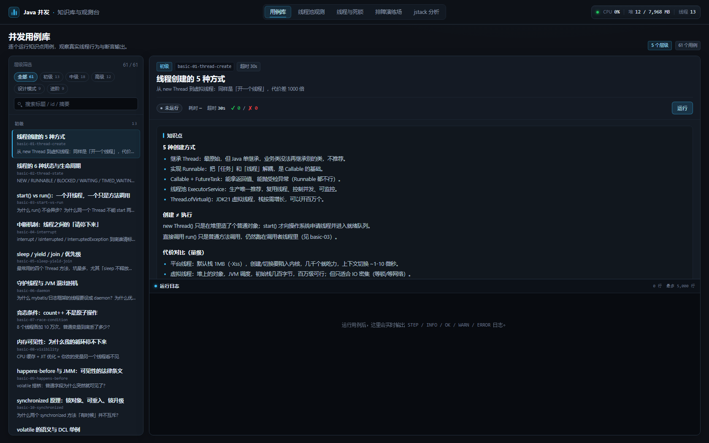
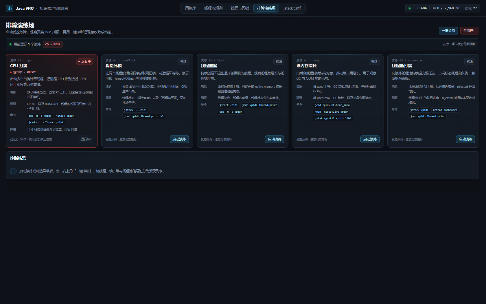
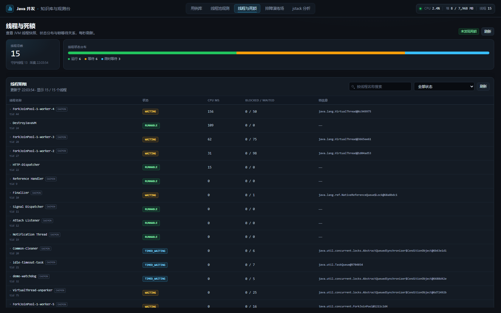
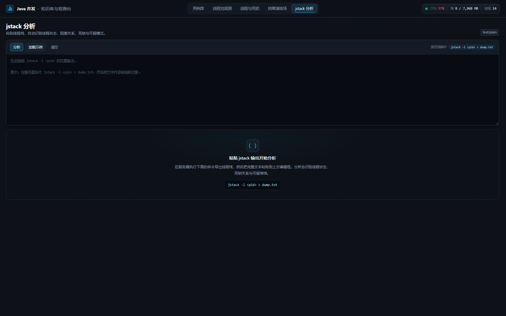

# Java 并发 · 知识库与观测台

一个**能跑起来**的 Java 多线程学习项目：61 个可执行用例 + 一个可观测控制台。
不背八股，每个知识点都能点一下看到真实行为、真实指标、真实故障。

- **零第三方依赖**：只用 JDK 21（`com.sun.net.httpserver` + 原生 JS），克隆即跑，不需要 Maven / Spring。
- **分四层递进**：初级概念 → 中级 JUC 工具 → 高级生产实践 → 进阶观测排障，另加 9 个并发设计模式。
- **每页都是讲义**：每个用例自带「知识点 + 最佳实践 + 分步输出 + 断言」，跑完就知道对没对。
- **能观测**：线程池曲线、线程状态分布、死锁检测、JVM 指标、一键诊断、jstack 文本分析。
- **能演练**：一键制造 CPU 打满 / 死锁 / 线程泄漏 / 堆增长 / 线程池打满，再用诊断把问题找回来。



---

## 快速开始

**环境**：JDK 21（虚拟线程、`case null` 等语法需要）。IDEA 里项目已配好 JDK 21。

### 方式一：IDEA（推荐）

1. 用 IDEA 打开 `testCase` 项目，等待索引完成；
2. 运行 `src/Main.java`；
3. 浏览器自动打开 <http://127.0.0.1:8080>（端口被占用会自动 +1）。

### 方式二：命令行

```bash
# 编译（Windows / Linux 都一样，注意 -encoding UTF-8）
javac -encoding UTF-8 -d build/classes $(find src -name "*.java" | tr '\n' ' ')

# 启动可视化控制台
java -Dfile.encoding=UTF-8 -cp build/classes Main --web 8080

# 只跑用例，不启动页面
java -cp build/classes Main --list
java -cp build/classes Main --run basic-07          # 支持 id 前缀
java -cp build/classes Main --level advanced        # 跑一整层
```

Windows PowerShell 里编译：

```powershell
$files = Get-ChildItem -Recurse -Path src -Filter *.java | ForEach-Object { $_.FullName }
& $env:JAVA_HOME\bin\javac -encoding UTF-8 -d build\classes @files
```

---

## 五层结构

| 层级 | 数量 | 回答的问题 | 代表用例 |
|---|---|---|---|
| 初级 · 基本概念 | 13 | 线程是什么？为什么变量改了看不见？锁到底锁谁？ | `basic-07-race-condition`、`basic-08-visibility` |
| 中级 · JUC 工具 | 18 | 线程池参数怎么填？Future、CompletableFuture、锁怎么选？ | `juc-02-thread-pool-executor`、`juc-06-completable-future` |
| 高级 · 生产实践 | 12 | 线上真敢用吗？超时、隔离、熔断、优雅停机怎么做？ | `adv-02-bulkhead`、`adv-05-timeout` |
| 设计模式 | 9 | 那些「优雅的并发代码」用了什么套路？ | `pattern-07-active-object`、`pattern-08-half-sync-half-async` |
| 进阶 · 观测排障 | 9 | 池子满了、CPU 100%、卡死不返回，怎么定位？ | `obs-01-cpu-hotspot`、`obs-08-fault-avalanche` |

### 初级：基本概念（`concurrency.basic`）

| id | 主题 | 核心结论 |
|---|---|---|
| `basic-01-thread-create` | 线程创建的 5 种方式 | 创建 ≠ 执行；生产只用线程池/虚拟线程 |
| `basic-02-thread-state` | 6 种状态与生命周期 | BLOCKED 等 monitor，WAITING 等 notify/lock |
| `basic-03-start-vs-run` | start() vs run() | run() 只是普通方法调用；Thread 只能启动一次 |
| `basic-04-interrupt` | 中断机制 | 中断是「请求」；catch 后要恢复标志位 |
| `basic-05-sleep-yield-join` | sleep/yield/join/优先级 | sleep 不释放锁；join 要带超时 |
| `basic-06-daemon` | 守护线程与 JVM 退出 | 非守护线程阻止退出；daemon 会被强杀 |
| `basic-07-race-condition` | 竞态条件 | `count++` 是「读-改-写」三步，必然丢更新 |
| `basic-08-visibility` | 内存可见性 | 没有 HB 关系，另一个线程可能永远看不到 |
| `basic-09-happens-before` | happens-before 与 JMM | 8 条规则；volatile 搭桥发布对象 |
| `basic-10-synchronized` | 锁对象、可重入、锁升级 | 锁的是对象；不同实例互不干扰；可重入 |
| `basic-11-volatile` | volatile 与 DCL | 可见性 ≠ 原子性；DCL 的 instance 必须 volatile |
| `basic-12-deadlock` | 死锁四条件与三种解法 | 固定加锁顺序 / tryLock 超时 / 可中断锁 |
| `basic-13-immutable` | 不可变与安全发布 | `unmodifiableList` 不是快照，`List.copyOf` 才是 |

### 中级：JUC 工具（`concurrency.juc`）

| id | 主题 | 核心结论 |
|---|---|---|
| `juc-01-executor-lifecycle` | 线程池生命周期 | submit 的异常藏在 Future 里；shutdown 与 shutdownNow |
| `juc-02-thread-pool-executor` | 七大参数与执行流程 | 队列满了才扩容到 max |
| `juc-03-rejection-policy` | 4 种拒绝策略 + Executors 的坑 | Discard 系列静默丢任务；队列必须自己指定容量 |
| `juc-04-pool-sizing` | 参数怎么算 | Little's Law：并发数 = QPS × RT |
| `juc-05-future` | Future 的三个坑 | get 超时不停止任务，必须 cancel |
| `juc-06-completable-future` | 编排全家桶 | thenCompose / allOf / exceptionally / orTimeout |
| `juc-07-reentrant-lock` | 可中断、可超时、可公平 | 需要这三项才用 Lock，否则 synchronized |
| `juc-08-read-write-lock` | 读写分离与 StampedLock | 锁降级合法，锁升级死锁 |
| `juc-09-condition` | 手写有界阻塞队列 | 两个 Condition 分别等待「不满」和「不空」 |
| `juc-10-semaphore` | 限流与资源池 | 许可数控制并发，release 必须 finally |
| `juc-11-latch-barrier-phaser` | 三种集合点 | latch 一次性、barrier 可循环、phaser 可动态 |
| `juc-12-blocking-queue` | 阻塞队列全家桶 | LinkedBlockingQueue 默认无界（危险） |
| `juc-13-producer-consumer` | 生产者-消费者两种写法 | 有界队列天然提供背压 |
| `juc-14-concurrent-collections` | CHM 与 COW | computeIfAbsent 原子；size 只是估算；迭代弱一致 |
| `juc-15-atomic` | CAS、ABA、LongAdder | 版本号解决 ABA；高并发计数用 LongAdder |
| `juc-16-thread-local` | ThreadLocal 与泄漏 | key 弱引用 value 强引用；用完必须 remove |
| `juc-17-fork-join` | 工作窃取 | 适合可分治的 CPU 密集任务，不适合阻塞 IO |
| `juc-18-virtual-threads` | 虚拟线程 | 10 万个线程 1 秒跑完；不要池化，注意 pin |

### 高级：生产实践（`concurrency.advanced`）

| id | 主题 | 核心结论 |
|---|---|---|
| `adv-01-thread-factory` | 线程工厂与异常处理 | 线程必须命名；execute 与 submit 的异常路径不同 |
| `adv-02-bulkhead` | 线程池隔离 | 共享池被慢任务打满，核心接口延迟从 0ms 变 800ms |
| `adv-03-degrade` | 拒绝与降级 | 拒绝之后要记录 + 降级 + 告警，不能静默 |
| `adv-04-graceful-shutdown` | 优雅停机 | shutdown 全保住，shutdownNow 丢任务 |
| `adv-05-timeout` | 超时控制 | `orTimeout` 不会停止底层任务，这是最大的坑 |
| `adv-06-context-propagation` | 上下文传递 | ThreadLocal 跨线程池会丢，必须包装 + finally 清理 |
| `adv-07-retry-backoff` | 重试与退避 | 重试放大流量；指数退避 + 抖动 + 幂等 |
| `adv-08-rate-limit-circuit-breaker` | 限流与熔断 | 令牌桶、三态熔断器 |
| `adv-09-backpressure` | 背压 | 有界队列把「OOM」变成「可观测的拒绝」 |
| `adv-10-lock-optimization` | 锁优化 | 锁内 IO → 锁外 IO，吞吐差 4 倍 |
| `adv-11-parallel-aggregation` | 并行聚合 | allOf + 单路超时 + 部分失败兜底 |
| `adv-12-batch-processing` | 批量处理 | 分批 + 限并发 + 单条失败重试 |

### 设计模式（`concurrency.pattern`）

| id | 模式 | 一句话 |
|---|---|---|
| `pattern-01-worker-thread` | Worker Thread | 线程池的本质：队列 + 常驻线程 |
| `pattern-02-future` | Future / Promise | `get()` 的本质就是 wait/notify |
| `pattern-03-guarded-suspension` | Guarded Suspension | 条件不满足就等，while + wait |
| `pattern-04-balking` | Balking | 条件不满足就返回，只初始化一次 |
| `pattern-05-thread-per-message` | Thread-Per-Message | 虚拟线程让它复活 |
| `pattern-06-two-phase-termination` | 两阶段终止 | 请求停止 + 等待善后，清理必须幂等 |
| `pattern-07-active-object` | Active Object | 单线程串行 = 无锁并发（Actor 思想） |
| `pattern-08-half-sync-half-async` | Half-Sync/Half-Async | IO 层与业务层分离，Netty 的核心结构 |
| `pattern-09-master-worker` | Master-Worker | 分片并行 + 结果汇总 + 失败隔离 |

### 进阶：观测排障（`concurrency.observe.demo`）

| id | 主题 | 学到什么 |
|---|---|---|
| `obs-01-cpu-hotspot` | 定位 CPU 热点线程 | `getThreadCpuTime` 采样 = Arthas `thread -n` |
| `obs-02-pool-metrics` | 线程池四指标 | active / queue / completed / rejected |
| `obs-03-deadlock-detection` | 死锁自动检测 | `findDeadlockedThreads` + 锁链路还原 |
| `obs-04-jstack-analysis` | jstack 文本分析 | 锁图找环、按业务栈聚合 |
| `obs-05-fault-cpu` | 演练：CPU 打满 | 制造 → 采样 → 诊断 → 恢复 |
| `obs-06-fault-thread-leak` | 演练：线程泄漏 | 数量趋势 + 名字前缀定位源头 |
| `obs-07-fault-queue-backlog` | 演练：无界队列 | 过载被藏进内存，故障发现最晚 |
| `obs-08-fault-avalanche` | 演练：雪崩 | 慢下游 → 池耗尽 → 全站不可用 |
| `obs-09-production-checklist` | 上线 Checklist | 20 条自检 + 真实环境体检 |

---

## 可视化控制台

启动后共 5 个页面，全部读真实 JVM 数据：

| 页面 | 能力 | 对应接口 |
|---|---|---|
| 用例库 | 按层级筛选/搜索、运行、实时日志、断言结果、停止 | `/api/demos`、`/api/runs/*` |
| 线程池观测 | 每个池的活跃/队列曲线、拒绝次数、最大池大小 | `/api/pools` |
| 线程与死锁 | 线程状态分布、线程列表、堆栈、死锁告警 | `/api/threads`、`/api/deadlocks` |
| 排障演练场 | 5 类故障演练 + 一键诊断 + 处置建议 | `/api/lab/*`、`/api/diagnose` |
| jstack 分析 | 粘贴线程转储，自动找死锁/阻塞点/热点栈 | `/api/dump/analyze` |

| 线程池观测 | 排障演练场 |
|---|---|
|  |  |

| 线程与死锁 | jstack 分析 |
|---|---|
|  |  |

---

## 建议学习路线

**第 1 天（初级）**：`basic-01` → `basic-05` 打基础；`basic-07` / `basic-08` 建立「并发会出什么事」的直觉；`basic-09` / `basic-11` 理解 JMM。

**第 2~3 天（中级）**：`juc-02` 线程池 → `juc-03` 拒绝策略 → `juc-04` 参数计算；`juc-06` CompletableFuture；`juc-09` / `juc-10` / `juc-11` 协调工具；`juc-14`~`juc-16` 容器与 ThreadLocal。

**第 4~5 天（高级）**：按「稳定性四件套」顺序看：`adv-05` 超时 → `adv-02` 隔离 → `adv-08` 熔断限流 → `adv-03` 降级；再看 `adv-04` 优雅停机、`adv-06` 上下文传递、`adv-01` 线程工厂。

**第 6 天（模式）**：`pattern-01` / `pattern-07` / `pattern-08` 理解线程池与 Netty 的底层结构；其余按兴趣。

**第 7 天（进阶）**：`obs-01`~`obs-04` 学会观测；`obs-05`~`obs-08` 亲手制造故障并诊断；最后用 `obs-09` 的 Checklist 检查自己的项目。

配套文档在 [`docs/`](docs/)：基础概念、JUC 速查、生产实战、设计模式、观测排障、面试自测。

---

## 项目结构

```
testCase/
├── src/
│   ├── Main.java                      # 入口：默认启动控制台
│   ├── resources/web/                 # 前端三件套（原生 JS，无构建）
│   └── concurrency/
│       ├── core/                      # 框架：Demo 接口、Runner、日志、线程池监控、JSON
│       ├── cli/                       # 命令行入口
│       ├── basic/                     # 初级 13 个
│       ├── juc/                       # 中级 18 个
│       ├── advanced/                  # 高级 12 个
│       ├── pattern/                   # 设计模式 9 个
│       ├── observe/                   # 观测能力：指标、线程巡检、诊断、演练、dump 分析
│       ├── observe/demo/              # 进阶 9 个
│       └── web/                       # HTTP 服务与 API
├── docs/                              # 知识文档 + 截图
└── testCase.iml                       # IDEA 模块（src 与 src/resources）
```

### 加一个用例有多简单？

```java
package concurrency.basic;

public class B14_MyDemo extends DemoBase {
    public B14_MyDemo() {
        super("basic-14-my-demo", Level.BASIC, "我的用例", "一句话摘要");
    }

    @Override
    public String knowledge() { return "## 知识点\n- ..."; }

    @Override
    public String bestPractice() { return "- 生产上应该..."; }

    @Override
    public void run(DemoContext ctx) throws Exception {
        ctx.step("① 演示");
        ctx.verify("断言", 1 + 1 == 2);
    }
}
```

**放到 `src/concurrency/**` 下就会被自动扫描**，页面和命令行都能看到，无需注册。
用例结束时会自动关闭它创建的线程池（`ctx.executor(...)` 托管）。

---

## 设计取舍

| 决策 | 原因 |
|---|---|
| 不引入 Maven / Spring | 学习项目要能「克隆即跑」，减少环境噪音；HTTP 用 JDK 自带 `HttpServer` |
| 用例是类而不是 `main` | 统一由 `DemoRunner` 执行，才能同时支持页面和 CLI，并统一超时/取消/日志采集 |
| 每个用例自带断言 | 让「跑通」有明确标准，而不是「看起来没报错」 |
| 用例执行在虚拟线程上 | JDK21 上更轻，也顺带展示虚拟线程；每个 run 一个线程，超时可中断 |
| 首屏自动选中第一个用例 | 支持 `#/demos/<id>` 深链，方便分享单个知识点 |

## 常见问题

**Q：8080 端口被占用？**
会自动尝试 8081/8082…，控制台会打印实际地址。也可以 `--web 9000` 指定。

**Q：页面中文乱码？**
页面统一 UTF-8；命令行如果乱码，加 `-Dfile.encoding=UTF-8 -Dstdout.encoding=UTF-8`，或 `chcp 65001`。

**Q：某些用例「没复现」？**
可见性、竞态这类问题依赖 JIT/CPU，用例里写了「没复现不代表安全」的说明。多跑几次或在服务端 JVM 上跑更容易复现。

**Q：端口/进程残留？**
控制台注册了 shutdown hook，Ctrl+C 会正常关闭。演练场的线程都是 daemon，不会阻止进程退出。

## 相关文档

- [01 线程基础与 JMM](docs/01-线程基础与JMM.md)
- [02 JUC 工具速查](docs/02-JUC工具速查.md)
- [03 生产并发实战](docs/03-生产并发实战.md)
- [04 并发设计模式](docs/04-并发设计模式.md)
- [05 观测与排障手册](docs/05-观测与排障手册.md)
- [06 面试高频自测](docs/06-面试高频自测.md)
